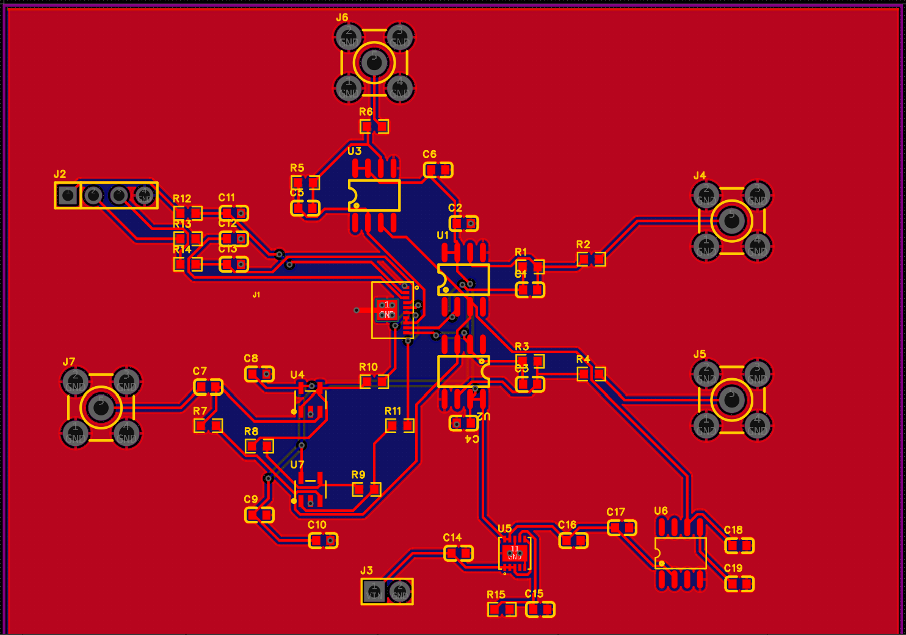
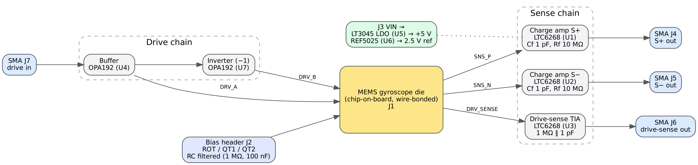
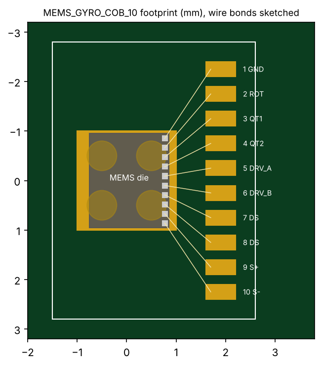

# MEMS Gyroscope Readout PCB

A 4-layer analog front-end board for a capacitive MEMS vibratory gyroscope. The bare MEMS die is mounted **chip-on-board** in the centre and wire-bonded directly to the PCB. Low-noise charge amplifiers sit a few millimetres away to read the differential sense electrodes. Around them are a differential drive stage, filtered electrode bias lines and a clean power supply.

Designed in **EasyEDA Pro**.

> **Status:** design complete (schematic ERC and PCB DRC both pass with 0 errors). **Not yet fabricated or tested.**



---

## Block diagram



| Block | Parts | What it does |
|---|---|---|
| **Sense chain** | U1, U2 (LTC6268) | Charge amplifiers for the differential sense electrodes S+ / S−. Cf = 1 pF C0G, Rf = 10 MΩ: about 1 V/pC charge gain above the ≈16 kHz feedback corner. |
| **Drive-sense pickoff** | U3 (LTC6268) | Transimpedance amplifier (1 MΩ ∥ 1 pF) on the drive-sense electrodes, for closing the drive loop externally. |
| **Drive chain** | U4, U7 (OPA192) | Buffer and unity-gain inverter that turn one drive input (J7) into differential drive signals DRV_A / DRV_B. |
| **Electrode bias** | R12–R14, C11–C13 | RC-filtered (1 MΩ / 100 nF) bias lines from header J2 to the rotor (ROT) and quadrature-tuning electrodes (QT1, QT2). |
| **Power** | U5 (LT3045), U6 (REF5025) | Ultra-low-noise +5 V LDO (RSET = 49.9 kΩ) and a 2.5 V mid-supply reference. |
| **I/O** | J3, J4–J7 | Power input (VIN ≥ 5.5 V) and SMA connectors: S+ out, S− out, drive-sense out, drive in. |

## MEMS die site (chip-on-board)



A custom footprint, `MEMS_GYRO_COB_10`, has a 2 × 2 mm grounded die-attach pad with thermal/ground vias and a row of 10 wire-bond pads (0.6 × 0.3 mm, 0.5 mm pitch). The bond pads have no solder paste.

| Bond pad | Net | Electrode |
|---|---|---|
| 1 | GND | Substrate / ground (also the die pad) |
| 2 | ROT | Rotor / proof-mass bias |
| 3 | QT1 | Quadrature tuning 1 |
| 4 | QT2 | Quadrature tuning 2 |
| 5 | DRV_A | Drive electrode A |
| 6 | DRV_B | Drive electrode B (antiphase) |
| 7, 8 | DRV_SENSE | Drive-sense pickoff |
| 9 | SNS_P | Sense electrode S+ |
| 10 | SNS_N | Sense electrode S− |

The footprint is in [`footprints/MEMS_GYRO_COB_10.kicad_mod`](footprints/MEMS_GYRO_COB_10.kicad_mod) (KiCad format; EasyEDA Pro can import it).

## Board

- 4 layers, about 89 × 64 mm
- Ground copper pours on top and bottom, with via stitching
- Vias 0.3 mm drill / 0.6 mm pad
- Mostly 0603 passives; C0G for all feedback capacitors

## Layout notes

- **The sense node is the critical part.** At the charge-amplifier inputs, parasitic capacitance adds noise gain and leakage adds offset. U1 and U2 are placed right next to the bond pads (U2 rotated 180° so its input faces the die), which keeps the SNS_P and SNS_N traces at about 5–6 mm.
- The die pad and bond pad 1 are tied straight into the ground pour with vias.
- Every op-amp has its decoupling capacitor at the supply pin with its own ground via.

## Before fabrication

- Order **ENIG or ENEPIG** surface finish: the bond pads need a wire-bondable surface (not HASL).
- In the BOM, J1 is the bare die. Exclude it from machine assembly; it is die-attached and wire-bonded separately.
- Planned improvements: guard rings around SNS_P / SNS_N driven at the reference voltage, solid inner ground and +5 V planes, and routing ROT / QT1 into their bond pads from outside the wire-bond area.

## Repository contents

```
images/       layout screenshot, block diagram, die-site drawing
footprints/   MEMS_GYRO_COB_10 chip-on-board footprint (KiCad .kicad_mod)
bom/          bill of materials (48 parts)
LICENSE       CERN-OHL-P v2
```

## Author

**Shahariar Ryehan**, MEMS and photoacoustic sensing
[sryehan.com](https://sryehan.com) · [Google Scholar](https://scholar.google.com/citations?user=laUgYMAAAAAJ)

## License

Hardware design released under the [CERN Open Hardware Licence v2, Permissive](LICENSE).
